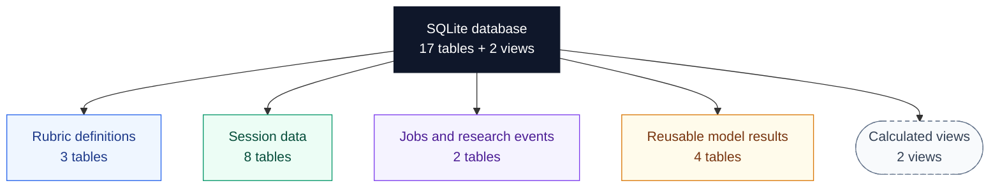
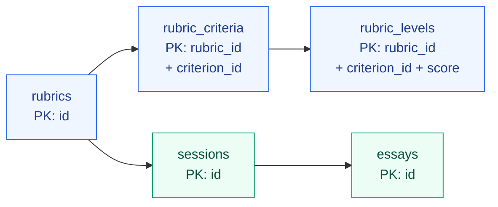
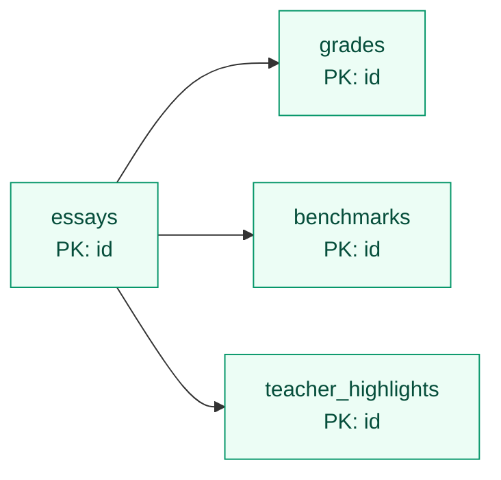
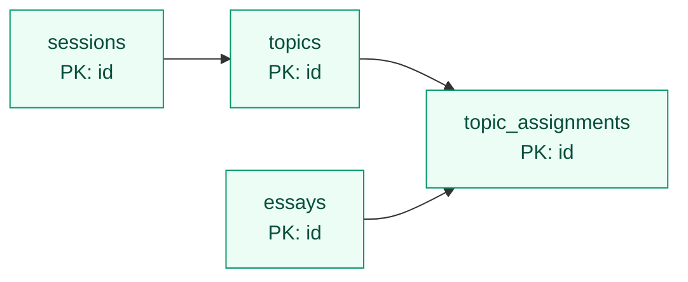
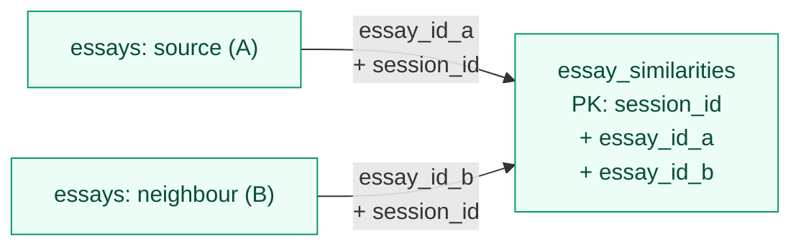
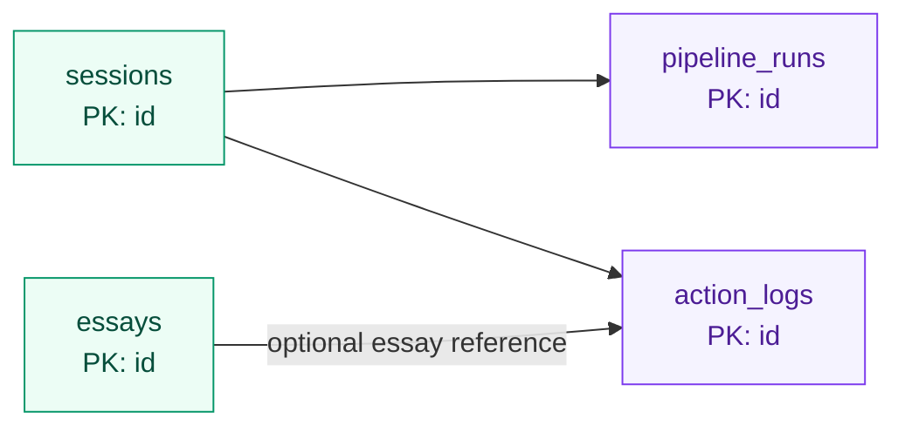
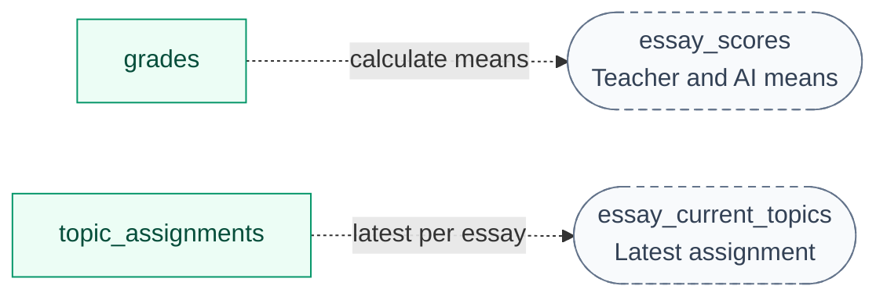

# Database map

**17 tables and 2 views**, stored in SQLite (`data/grading.db` by default).

## Overview

**Legend:** Overview arrows mean "contains". Other solid arrows run from parent to child
through a foreign key; dotted arrows show calculations. `PK` identifies a row, `FK` references
another table, and `+` joins columns into one key.

## 1. Rubrics and session ownership

Each imported essay has its own UUID; `dataset_essay_id` retains the original CSV ID.

## 2. Grading and teacher work

Shared FKs for `grades`, `benchmarks` and `teacher_highlights`:

| FK columns in each child | Referenced table | What it guarantees |
|---|---|---|
| `essay_id + session_id` | `essays` | Same session |
| `session_id + rubric_id` | `sessions` | Session's rubric |
| `rubric_id + criterion_id` | `rubric_criteria` | Valid rubric criterion |

## 3. Topics and assignment history

Assignments retain placement history. FKs: `essay_id + session_id` and `topic_id + session_id`.
A manual assignment with a null topic removes the essay from its group.

## 4. Similar essays

Both essay boxes refer to the same `essays` table.

Neighbours stay within one session. A listing B does not require B to list A; up to five
neighbours are stored per essay.

## 5. Jobs and research events

Logs may omit `essay_id`; otherwise `essay_id + session_id` must reference an essay in
that session.

## 6. Reusable model results

All four use `cache_key` as their PK and have **no FKs**. Matching inputs allow reuse
across sessions.

| Table | Saved result | Used for |
|---|---|---|
| `essay_summaries` | Summary text | Filling `essays.summary` |
| `essay_embeddings` | Vector and dimension count | Calculating similar-essay scores |
| `ai_assessments` | Assessment result/failure and attempts | AI precompute reuse |
| `topic_models` | Topic definitions and dataset-ID assignments | Creating session topics and initial placements |

Key inputs: [cache identities](database.md#model-result-identities).

## 7. Calculated views

Views calculate results when read; their boxes are rounded and dashed.

`essay_scores` ignores null scores; no scores gives a null mean. `essay_current_topics`
selects the highest assignment ID per essay.

Full definitions: [schema.sql](../src/server/db/schema.sql). All 21 FKs and migration details:
[database.md](database.md).
