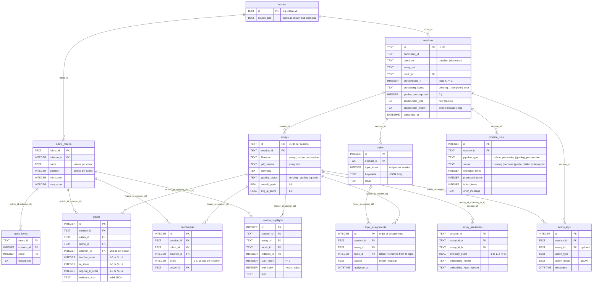

# Database

SQLite file at `data/grading.db` (override with `GRADING_DB_PATH`), opened with
`journal_mode = WAL` and `foreign_keys = ON` in `src/server/db/client.ts`.

The full schema, as plain DDL, is in [`src/server/db/schema.sql`](../src/server/db/schema.sql).
That file is generated from the migrations (`npm run db:schema`) and a test fails when it is
out of date; see [Migrations and schema.sql](#migrations-and-schemasql).

All SQL lives in `src/server/db/`, one module per area:

| Module | Tables |
|---|---|
| `rubrics.ts` | `rubrics`, `rubric_criteria`, `rubric_levels` |
| `sessions.ts` | `sessions` (plus progress and statistics queries) |
| `essays.ts` | `essays` (plus AI-quality ranking) |
| `topics.ts` | `topics`, `topic_assignments` |
| `grades.ts`, `benchmarks.ts`, `highlights.ts`, `similarities.ts` | one table each |
| `action-logs.ts` | `action_logs` |
| `caches.ts` | stored model results: `essay_summaries`, `essay_embeddings`, `ai_assessments`, `topic_models` |
| `pipeline-runs.ts` | `pipeline_runs` |
| `exports.ts` | read-only queries for the research export |
| `migrate.ts`, `migrations/` | schema versions |

## Entity-relationship diagram

Every line is a foreign key. References to an essay or topic include the session, and
references to a criterion include the rubric, with `(session_id, rubric_id)` pointing at the
session. So a row can only point at an essay or topic **of the same session**, and at a
criterion **of that session's rubric**.



The stored model results (`essay_summaries`, `essay_embeddings`, `ai_assessments`,
`topic_models`) are not in the diagram. They belong to no session: each is identified by a
hash of its inputs and shared by every session with the same inputs, so they have no foreign
keys (see [Stored model results](#stored-model-results)).

## Tables

### Reference data: the rubric

| Table | One row = | Keys and rules |
|---|---|---|
| `rubrics` | one version of the rubric | PK `id` (`essay-v1`). `source_text` is the rubric text shown to the teacher and sent to the model. |
| `rubric_criteria` | one criterion of a rubric | PK (`rubric_id`, `criterion_id`); name and position unique per rubric; `1 <= min_score < max_score <= 5`. |
| `rubric_levels` | the description of one score of a criterion | PK (`rubric_id`, `criterion_id`, `score`), foreign key to its criterion. |

A stored rubric never changes. The app's rubric is defined in code (`RUBRIC_ID` and
`RUBRIC_CRITERIA` in `src/lib/llm-config.ts`, text in `data/rubric/rubric.txt`) and stored
with the first session that uses it (`ensureRubric`). If a rubric with that id is already
stored with different criteria or text, session creation fails with `RubricConflictError`:
a changed rubric must get a new id. Each session keeps the rubric it started with, so a new
rubric never changes how existing grades are read.

### Core application state (source data and user decisions)

| Table | One row = | Keys and rules |
|---|---|---|
| `sessions` | one grading/study session | PK `id` (UUID); `rubric_id` references `rubrics`. CHECKs on condition, statuses, assessment options and 0/1 flags. |
| `essays` | one essay inside one session | PK `id` (UUID). UNIQUE (`session_id`, `filename`): a dataset ID appears once per session. The text is copied per session. Also holds derived fields (`summary`, `avg_ai_score`). |
| `grades` | one essay × criterion in a session | UNIQUE (`session_id`, `essay_id`, `criterion_id`). Teacher and AI score side by side, each 1–5 or NULL ("not scored yet"); `original_ai_score` keeps the first AI score after a revision. Written with a single `INSERT … ON CONFLICT DO UPDATE`; `rubric_id` is taken from the session in the same statement. |
| `benchmarks` | the benchmark essay for one criterion and score | UNIQUE (`session_id`, `criterion_id`, `score`). |
| `teacher_highlights` | one highlighted span | `0 <= start_index < end_index`. The upper bound (essay length) and the text match are checked in `src/server/validation/highlight.ts`, since a CHECK cannot read another table. |
| `topic_assignments` | one placement of an essay in a topic | Append-only. `source` is `model` (the topic model) or `manual` (the teacher); only a manual row may have no topic. The view `essay_current_topics` gives each essay's latest row. |

**Why topic assignments are a history table.** The topic model's assignment and the
teacher's corrections are both research data: where the teacher disagrees with the model is a
result in itself. With a single `topic_id` column, a correction overwrites the model's choice.
With an append-only table, the model's assignment stays and every correction is added after
it; the current topic is the latest row, read through the view. The research export includes
the full history.

### Derived / model data

| Table | Identity | Notes |
|---|---|---|
| `topics` | UNIQUE (`session_id`, `topic_index`) | Copied from a topic model result. |
| `essay_similarities` | PK (`session_id`, `essay_id_a`, `essay_id_b`) | Top-5 nearest neighbours per essay, directed; cosine similarity in [-1, 1], never an essay with itself. `embedding_model` and `embedding_input_version` name the embeddings it was computed from (NULL only on rows computed before they were recorded). A session's rows are replaced together, so they always come from one model. |

### Stored model results

Each row is identified by `cache_key`, a SHA-256 over every input that produced it
(`src/lib/cache-key.ts`), and keeps those inputs as columns so any result can be traced back:

| Table | Identity (inputs in the key) | Notes |
|---|---|---|
| `essay_summaries` | essay text hash, model, prompt version | |
| `essay_embeddings` | essay text hash, model, input version (first 8000 characters) | `dimensions` must equal the vector's length (CHECK). All vectors of one model and input version must have the same length: the cohort pipeline fails an essay whose vector differs from the length already stored for that model. |
| `ai_assessments` | essay text hash, criterion hash (name, score range, level descriptions as prompted), model, prompt version, assessment type and length | `status` `success` (score and justification required) or `failed` (error required); `attempts` counts how often the model was asked. Failures are never reused as results. |
| `topic_models` | essay set, hash of the essay IDs and texts, k, embedding model, label model, method version | `preprocessing` records whether keywords came from spaCy or scikit-learn. |

These tables have no foreign keys on purpose. A result is reused by any session whose inputs
match, so it cannot belong to one session; and an assessment is tied to the criterion's
definition (its hash), not to a rubric version, so an unchanged criterion in a new rubric
reuses it.

The dataset essay ID is deliberately **not** part of any key: the same ID with edited text
is a different input. Model names are Ollama tags; a tag re-pulled with new weights is not
detected.

`legacy_essay_summary_cache`, `legacy_ai_assessment_cache` and `legacy_topic_model_cache`
appear only in databases whose migration-1 cache tables held rows. They are kept as research
provenance; their rows do not record the model or prompt that produced them, so the app does
not read them.

### Operational / research data

| Table | Notes |
|---|---|
| `action_logs` | Append-only research events: what participants did. `essay_id` (optional) must be an essay of the same session. Also holds quality-rank snapshots. |
| `pipeline_runs` | What the background pipelines did: one row per run with configuration (models, versions, rubric, options; no essay text), an input hash, expected / processed / failed item counts, start and end time and error summary. A partial unique index allows only one `running` run per session and pipeline. A run marked `running` by an earlier server process is set to `interrupted`. |

Mental model: application tables are the current truth, `action_logs` is what the user did,
`pipeline_runs` is what the backend did.

## Indexes

Most primary and unique keys double as the index for the queries that need them. Extra
indexes cover the rest:

| Index | Used by |
|---|---|
| `idx_topic_assignments_essay` (`essay_id`, `id`) | an essay's current topic (the view) |
| `idx_topic_assignments_session` (`session_id`, `id`) | progress counts, research export |
| `idx_highlights_session_essay` (`session_id`, `essay_id`, `start_index`) | highlights of one essay |
| `idx_essay_embeddings_model` (`model`, `input_version`, `dimensions`) | dimension check before similarities |
| `idx_action_logs_session_time` (`session_id`, `timestamp`) | log export, timing metrics |
| `idx_action_logs_session_type` (`session_id`, `action_type`, `timestamp`) | rank history, precompute progress |
| `idx_topic_models_inputs`, `idx_pipeline_runs_latest`, `idx_pipeline_runs_one_running` | cached topic k values, latest run, one running run |

Query plans (`EXPLAIN QUERY PLAN`) for the main per-session queries:

```text
essays + current topic       SEARCH e USING INDEX sqlite_autoindex_essays_2 (session_id=?)
                             | SEARCH ta USING INDEX idx_topic_assignments_essay (essay_id=?) LEFT-JOIN
                             | CORRELATED SCALAR SUBQUERY | SEARCH latest USING COVERING INDEX idx_topic_assignments_essay (essay_id=?)
grades of an essay           SEARCH g USING INDEX sqlite_autoindex_grades_1 (session_id=? AND essay_id=?)
                             | SEARCH rc USING INDEX sqlite_autoindex_rubric_criteria_1 (rubric_id=? AND criterion_id=?)
                             | USE TEMP B-TREE FOR ORDER BY   (one row per criterion)
criteria of a rubric         SEARCH rubric_criteria USING INDEX sqlite_autoindex_rubric_criteria_3 (rubric_id=?)
topic assignments            SEARCH topic_assignments USING INDEX idx_topic_assignments_session (session_id=?)
similar essays               SEARCH essay_similarities USING INDEX sqlite_autoindex_essay_similarities_1 (session_id=? AND essay_id_a=?)
                             | USE TEMP B-TREE FOR ORDER BY   (at most 5 rows)
benchmarks of a criterion    SEARCH benchmarks USING INDEX sqlite_autoindex_benchmarks_1 (session_id=? AND criterion_id=?)
highlights of an essay       SEARCH teacher_highlights USING INDEX idx_highlights_session_essay (session_id=? AND essay_id=?)
embedding dimensions         SEARCH essay_embeddings USING COVERING INDEX idx_essay_embeddings_model (model=? AND input_version=?)
log export                   SEARCH action_logs USING INDEX idx_action_logs_session_time (session_id=?)
rank history                 SEARCH action_logs USING INDEX idx_action_logs_session_type (session_id=? AND action_type=?)
```

`tests/integration/database.test.ts` checks these plans, so a schema change that loses an
index fails the tests. Foreign key child columns are not indexed separately: parent rows are
never deleted, so SQLite never has to look up children.

## Migrations and schema.sql

The schema version is SQLite's `PRAGMA user_version`. On startup `migrate()` applies every
newer migration from `src/server/db/migrations/`, each in its own transaction together with
the version bump.

| Version | Migration | What it does |
|---|---|---|
| 1 | `001-baseline.ts` | The base schema. A database without a schema version is brought to the same shape (missing columns added); a `benchmarks` table in the `'low'/'high'` format is renamed to `benchmarks_legacy_low_high` so its rows are kept. |
| 2 | `002-integrity.ts` | Rebuilds the core tables with foreign keys, unique keys and CHECKs and adds the indexes. |
| 3 | `003-model-results.ts` | Adds the stored-result tables keyed by all inputs. Migration-1 cache tables with rows are renamed to `legacy_*`; empty ones are dropped. |
| 4 | `004-pipeline-runs.ts` | Adds `pipeline_runs`. |
| 5 | `005-rubrics-and-topic-assignments.ts` | Adds the rubric tables and links sessions, grades, benchmarks and highlights to them; adds `topic_assignments` and its view in place of `essays.topic_id`; records the embedding model on similarities; makes `action_logs.essay_id` a foreign key; drops unused columns. Existing sessions get rubric `essay-v1` with their rubric text. |

- If existing rows break a rule a migration adds (a duplicate grade, an out-of-range score,
  a reference to a missing essay), or cannot be carried over without guessing (migration 5:
  more than one rubric text, a criterion outside the rubric, values in a column it would
  drop), the migration stops and rolls back, and the error names the table and the problem.
  The app does not start until the data is fixed.
- A migration is not edited once released; a schema change is a new migration.
- `tests/integration/database.test.ts` runs the migrations on a new database and on a
  database without a schema version, including the failure cases.

**Why migrations in TypeScript, plus a generated schema.sql.** Several migrations do more
than DDL: they check existing rows before changing anything, rebuild tables (the only way to
add constraints in SQLite), and carry data into new shapes (rubric ids, topic history). That
logic needs code, and keeping every migration in one runner keeps their order and transaction
handling in one place. A reader who only wants the current schema should not have to replay
five migrations in their head, so `src/server/db/schema.sql` holds the result as plain SQL.
It is generated, not hand-written: `tests/integration/schema.test.ts` builds a database from
the migrations and compares it with the file, so the two cannot drift apart. After adding a
migration, run `npm run db:schema` and commit the updated file.

## Known limitations

- The 1–5 score range is written into the CHECK constraints. A rubric with another scale
  needs a migration (and a different grading prompt).
- Several fields are derived and stored for speed (`essays.summary`, `essays.avg_ai_score`,
  `essays.overall_grade`), so they must be updated together with their sources.
- `essay_similarities` rows from before migration 5 have no recorded embedding model.
