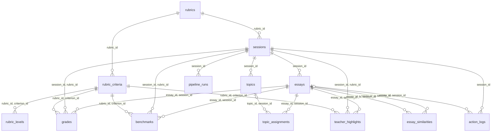

# Database

SQLite defaults to `data/grading.db`; `GRADING_DB_PATH` overrides it. The first `getDb()`
call opens a shared connection, requests WAL mode, enables foreign keys and applies migrations.
There is no separate DB service or ORM.

[`schema.sql`](../src/server/db/schema.sql) is the generated schema reference. Query modules
in [`src/server/db/`](../src/server/db/) own application SQL; `caches.ts` handles reusable
model outputs, `pipeline-runs.ts` handles jobs, and `exports.ts` selects research-export rows.

## Tables and keys

The fresh schema has 17 application tables, two views, 21 FK constraints and nine explicit
indexes. A composite key uses the listed columns together. `id` is a UUID for sessions/essays,
a version label for rubrics, and an auto-incrementing integer for other entity/event tables.

| Table | Primary key | One row represents |
|---|---|---|
| `rubrics` | `id` | Frozen rubric source text |
| `rubric_criteria` | `rubric_id, criterion_id` | Ordered criterion with name and score range |
| `rubric_levels` | `rubric_id, criterion_id, score` | Score-level description |
| `sessions` | `id` | Participant, condition, set, rubric, options and lifecycle |
| `essays` | `id` | Imported text and metadata for one session |
| `grades` | `id` | Current teacher/AI assessment of one essay criterion |
| `benchmarks` | `id` | Example essay for a criterion/score slot |
| `teacher_highlights` | `id` | Teacher-selected text span |
| `topics` | `id` | Session topic label and keywords |
| `topic_assignments` | `id` | Model/manual placement, retained as history |
| `essay_similarities` | `session_id, essay_id_a, essay_id_b` | Directed neighbor and cosine score |
| `essay_summaries` | `cache_key` | Reusable summary |
| `essay_embeddings` | `cache_key` | Reusable vector |
| `ai_assessments` | `cache_key` | Assessment result or failed attempt |
| `topic_models` | `cache_key` | Topic list and dataset-ID assignment map |
| `pipeline_runs` | `id` | Background attempt, configuration, counts and outcome |
| `action_logs` | `id` | Research event or rank snapshot |

`essays.essay_text` holds text; `source_path` records the CSV path and `dataset_essay_id` the
original CSV ID. `filename` in API results is a display label (`essay-<id>`), not a stored column.
`grades.criterion_name` in query results is joined from `rubric_criteria`, not stored again.

See the [database flowchart](database-flowchart.md) for the table groups and read path.

## Relationships and constraints

Each diagram edge is a declared FK. Optional topic/event essay references may be null.
The four result caches are independent of sessions and have no FKs.

Composite FKs keep essay/topic references within the session and grade/benchmark/highlight
criteria within that session's rubric. No cascade-delete rules are declared.

Other keys prevent duplicate dataset IDs per session, criterion names/positions, topic indices,
grade rows and benchmark slots. CHECKs require non-null primary keys, integer values in INTEGER
columns, valid statuses, JSON container types, vector length and run counts/timestamps. Triggers
keep rubric levels, grades and benchmarks within their criterion's range. Runtime validators
also check highlight text/upper bounds and model-output details; SQL does not verify quote truth.
See the [DDL](../src/server/db/schema.sql) for individual columns, defaults and constraints.

## Current state and history

- A rubric ID cannot be reused with changed text/criteria through `ensureRubric()`. Sessions
  reference their saved version.
- `grades` has one row per `(session_id, essay_id, criterion_id)`. Upserts change only supplied
  fields; explicit null clears a field. SQLite records the first saved non-null AI score as
  `original_ai_score`; triggers prevent replacement or clearing. Clients cannot set it.
- Topic moves append `topic_assignments`. `essay_current_topics` selects each essay's latest ID,
  retaining the model's initial placement and teacher corrections.
- `essays.summary` is a saved model result. `essay_scores` calculates `overall_grade` and
  `avg_ai_score` from the non-null criterion scores at read time. No scores gives null; partial
  grading averages only scored criteria. Edits, clears and deletes take effect immediately.
  Session grade statistics include only essays marked graded.
- `action_logs` appends research events. `pipeline_runs` creates a row per attempt and updates
  its progress/outcome; run rows themselves are not immutable.

## Model-result identities

Keys are SHA-256 hashes built in [`cache-key.ts`](../src/lib/cache-key.ts).

| Store | Inputs in its key |
|---|---|
| `essay_summaries` | Full text hash, model, summary prompt version |
| `essay_embeddings` | Full text hash, model, input version (currently first 8,000 characters) |
| `ai_assessments` | Full text hash, criterion definition hash, model, prompt version, format and length |
| `topic_models` | Set, sorted dataset IDs/text hashes, k, embedding/label models and method version |

Results are shared across matching sessions. Assessments record success/failure, error and
attempt count; precompute reuses only successes when allowed. Stored topic preprocessing mode
is not part of its key. Model weight changes under the same tag are not detected. Python may
reread source CSV text/order, and existing session outputs can bypass new cache lookups.

## Indexes

PK/UNIQUE indexes cover most scoped queries. Explicit indexes support:

- Latest topic assignment by essay, and assignment history by session.
- Ordered highlights, embedding-dimension lookup and cached topic k values.
- Latest pipeline run and one running row per `(session_id, pipeline_type)`.
- Session events by timestamp and by action type for rank history.

[`database.test.ts`](../tests/integration/database.test.ts) checks 11 query plans for index
use and no table scans; only the similarity query permits a temporary sort. The full index
definitions are in `schema.sql`.

## Migrations

[`migrate.ts`](../src/server/db/migrate.ts) reads `PRAGMA user_version` and applies the ordered
[`migrations/`](../src/server/db/migrations/) list. Each step and version bump form one
transaction. FK checks run before commit; enforcement is restored afterward.

| Version | Change |
|---|---|
| 1 | Base tables; upgrades recognized pre-migration layouts and preserves old low/high benchmarks |
| 2 | Constrained table rebuilds and indexes |
| 3 | Input-keyed result stores; retires old caches |
| 4 | Pipeline run records and admission index |
| 5 | Rubric tables, topic history/view, similarity model metadata and log essay FK |
| 6 | Clearer essay columns, calculated score view, integer/key/JSON constraints and score guards |

Version 6 preserves source records and existing original AI scores, and replaces stored averages
with calculations from saved grades. For older grades without an original AI score, it uses the
current AI score; earlier unsaved scores cannot be recovered. Invalid existing values stop the
migration and leave version 5 intact. It does not round or silently discard invalid records.

A failed step rolls back that step; earlier successful steps remain committed. A database
newer than the app is rejected. Ambiguous legacy rubric data or values in columns scheduled
for removal stop migration rather than being discarded. There is no down-migration command.

Nonempty old caches are preserved as `legacy_essay_summary_cache`,
`legacy_ai_assessment_cache` and `legacy_topic_model_cache`; runtime code does not read them.
Empty old caches are dropped. Early benchmark rows may remain in `benchmarks_legacy_low_high`.

Add a new migration for schema changes, then run `npm run db:schema` and commit the generated
snapshot. Normal schema tests compare without rewriting it. See [testing.md](testing.md).
